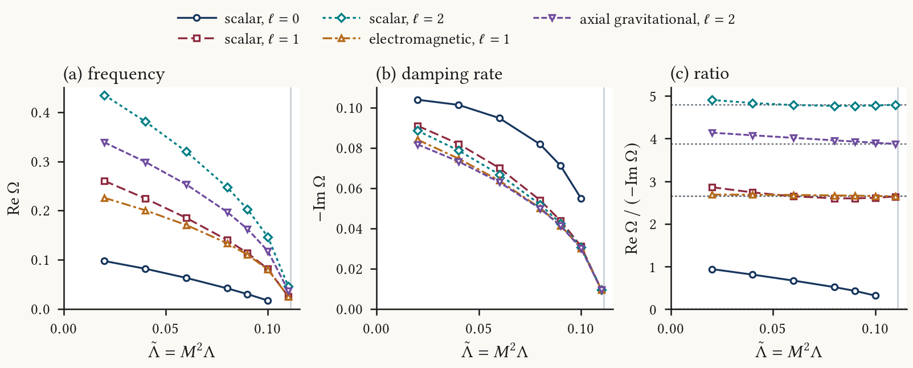
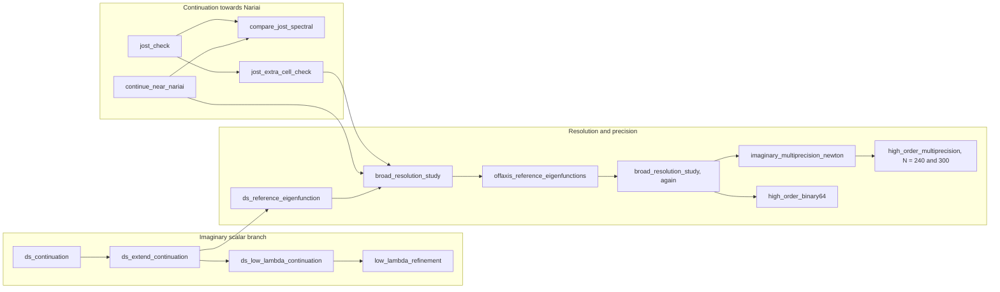

<!-- Author: Dr. Denys Dutykh (Mathematics Department, Khalifa University of Science and Technology, Abu Dhabi, UAE) -->

# massless-SdS: quasinormal modes of Schwarzschild–de Sitter black holes and the Nariai limit



The least damped oscillatory quasinormal mode Ω = Mω of five perturbations against the dimensionless cosmological
constant Λ̃ = M²Λ, read from the tables of `data/nonextreme/` (the folder of the scalar monopole at Λ̃ = 0.11 holds no
table of its own, see Contents). Panels (a) and (b) show that the frequency and the damping rate both decrease towards
zero as Λ̃ approaches 1/9 (vertical line), where the event and cosmological horizons merge. Panel (c) shows that their
ratio tends to 2√(A_s − 1/4) (dotted lines), the ratio of the fundamental frequency of the Pöschl–Teller problem of the
Nariai limit, with A_s = ℓ(ℓ+1) for the scalar and electromagnetic fields and ℓ(ℓ+1) − 2 for the gravitational field;
at Λ̃ = 0.11 the four ratios are within 0.2 % of their limits. For the scalar monopole, A_s = 0 and the limit is 0.

massless-SdS holds the codes and data of a study of the quasinormal modes of four-dimensional Schwarzschild–de Sitter
black holes by Davide Batic, Anna Chrysostomou, Alan S. Cornell and Denys Dutykh, for massless scalar, electromagnetic
and gravitational perturbations (the latter in both parities). After the behaviour at the two horizons is factored out,
the radial problem becomes a quadratic eigenvalue problem on −1 ⩽ y ⩽ 1, solved by a Chebyshev spectral method for
0 < Λ̃ < 1/9; the Nariai limit Λ̃ = 1/9 is treated as a separate spectral problem, whose exact Pöschl–Teller spectrum
serves as a benchmark. Maple assembles the matrices, MATLAB (with the Advanpix toolbox) or Julia solves the problem,
and Mathematica notebooks compare the results with WKB estimates and draw the spectra.

The revision of the manuscript (November 2026) added a fourth language. Python programs, collected in `python/`, test
the spectral results by methods independent of Maple and Julia: they follow six oscillatory branches and one purely
imaginary scalar branch towards the Nariai limit, check three representative modes up to N = 300 in double and in
70-digit arithmetic, decide which roots of the Nariai pencil are physical through the Jost Wronskian, compare the axial
and polar gravitational spectra, compute the Schwarzschild column of the tables by Leaver's continued fraction, and
verify the algebra of the paper exactly. The Julia solver of the Nariai problem now selects its modes by the same
radiation test. The manuscript, "Quasinormal modes of Schwarzschild–de Sitter black holes: spectral branches and the
Nariai limit", is included as `pdf/SCHWARZSCHILD_DE_SITTER_MASSLESS.pdf` in its version of 6 June 2026, before the
revision; it has not been published, so the software itself is to be cited (see How to cite).

## The problem

In units with c = G = ℏ = 1 and with the time dependence e^(−iωt), the line element and the radial equation of the
scalar (s = 0) and electromagnetic (s = 1) perturbations are

```text
ds² = −f(r) dt² + dr²/f(r) + r² (dϑ² + sin²ϑ dφ²),      f(r) = 1 − 2M/r − Λr²/3,      Λ > 0,

f d/dr( f dψ/dr ) + ( ω² − U(r) ) ψ = 0,      U(r) = f(r) ( ε f′(r)/r + ℓ(ℓ+1)/r² ),      ε = 1 − s².
```

Gravitational perturbations of odd parity replace U by the Regge–Wheeler potential, and those of even parity by the
Zerilli-type potential of equation (6) of the manuscript:

```text
V_odd(r) = f(r) ( ℓ(ℓ+1)/r² − 6M/r³ ),      ℓ ⩾ 2.
```

With x = r/(2M), Λ̃ = M²Λ and Ω = Mω, the lapse is f(x) = 1 − 1/x − (4Λ̃/3) x². For 0 < Λ̃ < 1/9 it has two positive
zeros, the event horizon x_h and the cosmological horizon x_c,

```text
x_h = cos( (π + α)/3 ) / √Λ̃,      x_c = cos( (π − α)/3 ) / √Λ̃,      α = arccos( 3√Λ̃ ),
```

which merge at x = 3/2 when Λ̃ = 1/9. A quasinormal mode is ingoing at the event horizon and outgoing at the
cosmological horizon. Once these behaviours are factored out, the remaining function is expanded in Chebyshev
polynomials of the first kind on −1 ⩽ y ⩽ 1 and the equation is collocated, which gives the quadratic pencil

```text
( M0 + i Ω M1 + Ω² M2 ) a = 0.
```

It is solved at three resolutions, and a root is kept when the three agree: the nearest roots at the three resolutions
must lie within max(10⁻⁴, 10⁻⁴ · max(1, |Ω|)) of each other, and their average is reported.

In the Nariai limit the radial equation becomes a Pöschl–Teller problem in its own time coordinate, with the frequency
ϖ and the coefficient A_s = ℓ(ℓ+1) for s = 0 and 1 and A_s = ℓ(ℓ+1) − 2 for s = 2. Its quasinormal frequencies are
known exactly (equation (90) of the manuscript), and near extremality they are related to Ω by

```text
ϖ_n = ± √(A_s − 1/4) − i (n + 1/2),   n = 0, 1, 2, ...,            ϖ = Ω / ( Λ̃ (x_c − x_h) ),
```

so that the raw frequencies Ω are not to be compared with ϖ directly.

A root of the Nariai pencil is a quasinormal frequency only if it satisfies the radiation conditions at both ends,
which the regularity of the factored solution does not guarantee. The revised manuscript tests them through the Jost
solutions of the Pöschl–Teller problem in its tortoise coordinate χ*,

```text
q = (1 + tanh χ*)/2,      a = 1/2 + √(1/4 − A_s),      b = 1/2 − √(1/4 − A_s),      c = 1 − iϖ,

J₋(χ*) = e^(−iϖχ*) ₂F₁(a, b; c; q),      J₊(χ*) = J₋(−χ*),

F = ₂F₁(a, b; c; 1/2),      P = −iϖ F + F_q/2,      W[J₋, J₊] = −2 F P,      D = W / ( |F|² + |P|² ),
```

where F_q is the derivative of ₂F₁(a, b; c; q) with respect to q at q = 1/2, and a root ϖ passes when |D| ⩽ 10⁻⁸. For
A_s > 0 the zeros of W are the Pöschl–Teller frequencies above. For the scalar monopole, A_s = 0, one has F = 1 and
W = 2iϖ: the exact Nariai monopole has no nonzero quasinormal mode, the roots 0, −i, −2i, ... of its regularised pencil
fail the radiation conditions, and ϖ = 0, the constant solution, is a static threshold.

## Quick start

First, Maple assembles the three matrices `M0`, `M1` and `M2` of one case at each resolution: the worksheets
`maple/Matrix_Assembler_*.mw` (see Contents) set the sector, the multipole ℓ, the cosmological constant and the
resolutions, and write the matrices as ASCII files into the folder that the Julia solver reads, under the names it
expects (as saved, all four worksheets last assembled N = 90, 95 and 100).

Second, the pencil is solved, in one of two ways. In Julia, `julia/QNMSdS_readable_output.jl` reads the matrices
`M0-<N>-<tag>.mat`, `M1-<N>-<tag>.mat` and `M2-<N>-<tag>.mat`, the tag being 1000 Λ̃, linearises the pencil, solves it in
`BigFloat` arithmetic with GenericSchur, applies the three-resolution test and writes the table of retained modes
(`stable_modes-<tag>.txt`, with `_details` and `_full_precision` companions), the spectra and pictures of them. The
Nariai solver `julia/QNM_Nariai.jl` does the same with the tag `s<s>_ell<ℓ>` (by default s = 2 and ℓ = 3), then keeps a
matched root only when the Jost determinant satisfies |D| ⩽ 10⁻⁸ at each of the three roots that form it and at their
average, evaluated with 80 and with 120 digits, which must agree within 10⁻³⁰; the exact Pöschl–Teller frequencies
enter only afterwards, to measure the error of the retained modes. Besides the table of retained modes and its
comparison with the exact values, it writes the Jost residual of every root of each spectrum
(`jost_audit_raw-N<N>-<tag>.dat`) and of every matched root, and the matched roots that fail the test; for A_s = 0 it
writes no table of modes but a statement that the sector has none, with the numerical candidate for the threshold
ϖ = 0. Its results go to the folder `Julia_referee2_point5/<tag>` inside the folder of the matrices.

Both Julia files set their parameters as constants near the top, to be edited before a run: the folder of the matrices
`DATA_DIR` (a folder of the authors' computer by default), the resolutions `N_VALS` (90, 95 and 100 by default), the
tag or the sector (`FILETAG`, `SPIN`, `ELL`) and the precision (70 digits, the matrices coming from Maple with 50; the
constant `FILE_DECIMAL_DIGITS` is not used). With GenericSchur 0.5.9 the generalised problem `eigvals(A, B)` has no
method for complex `BigFloat` matrices, so both solvers print a warning and compute the eigenvalues of B⁻¹A instead,
which requires `M2` to be invertible. In MATLAB with the Advanpix Multiprecision Computing Toolbox,
`matlab/chaseeigs.m` reads the resolutions from `resolutions.txt` and s, ℓ and Λ̃ from the first three lines of
`params.txt` in the working folder, and the matrices from `assemble/M0_<N>.mat`, `assemble/M1_<N>.mat` and
`assemble/M2_<N>.mat` (other names than those of the Julia solver, so the files are to be copied under these names);
it solves the problem with `mp.Digits(N)`, as many decimal digits as the resolution, and writes every root, real and
imaginary parts in two columns, into `results/eigs_<N>.dat`. Its first lines add the toolbox from a fixed folder, which
must be changed to that of the local installation.

Third, the notebooks of `mathematica/` compare and draw the results. `CompareViaZhidenko_SdS.nb` loads the WKB package
from its own folder, so `matlab/WKB.m` must first be copied into `mathematica/`.

Fourth, the programs of `python/` check the results independently (see Independent checks). Each one runs from that
folder, for instance as `python3 checks/r2p5/parity_check.py`, and rewrites the results saved beside it.

## Contents

| Folder | What it holds |
|---|---|
| `maple/` | the matrix assemblers `Matrix_Assembler_s0_s1-Final Version.mw` (scalar and electromagnetic), `Matrix_Assembler_s2odd-Final Version.mw` (odd gravitational), `Matrix_Assembler_s2even-Final Version.mw` (even gravitational) and `Matrix_Assembler_all_s_Nariai-Final Version.mw` (Nariai limit), and the five worksheets `01-...-SUPPLEMENTAL MATERIAL.mw` with the derivations (Frobenius analysis, compactification, coefficients) |
| `matlab/` | `chaseeigs.m`, the multiple-precision solver, and `WKB.m`, a Wolfram Language package (not MATLAB code) of higher-order WKB formulas used by the notebook, credited below |
| `julia/` | `QNMSdS_readable_output.jl`, the solver and the three-resolution test for 0 < Λ̃ < 1/9, and `QNM_Nariai.jl`, its counterpart for the Nariai limit, which selects the modes by the Jost test |
| `mathematica/` | `CompareViaZhidenko_SdS.nb`, the potentials and the comparison of the spectral modes with WKB and semi-analytic estimates, and `QNMplots.nb`, which reads tables of modes and draws spectra in the complex plane (for instance the gravitational ℓ = 2 case at Λ̃ = 0.11 and its Nariai counterpart) |
| `python/` | the independent checks of the revised manuscript, with their saved results, run logs and notes on their methods |
| `data/nonextreme/` | one folder per scalar or electromagnetic case, with a table of modes and the raw spectra in `raw/`; the gravitational tables in `s2/odd/` and `s2/even/` |
| `data/extreme/` | the four tables of the Nariai limit |
| `pdf/` | the manuscript as it stood on 6 June 2026, before its revision |
| `docs/figures/` | the script that draws the figure of this page from the tables of `data/nonextreme/`, and the style file beside it |

The folders of `data/nonextreme/` are named `s<s>_L<ℓ>_La0_<digits>`, the digits being those of Λ̃ after the decimal
point (`La0_06` is Λ̃ = 0.06, `La0_1` is 0.10 and `La0_11` is 0.11). They cover the scalar field with ℓ = 0, 1 and 2 and
the electromagnetic field with ℓ = 1 and 2, at Λ̃ = 0.02, 0.04, 0.06, 0.08, 0.09, 0.10 and 0.11; the odd gravitational
tables cover ℓ = 2 and 3 at the same seven values, and the even ones ℓ = 2 at Λ̃ = 0.02, 0.06, 0.08 and 0.09, for the
comparison of the two parities. Their common modes agree, as the Chandrasekhar–Darboux relation predicts; the odd
tables list a few more overtones and, at Λ̃ = 0.06, 0.08 and 0.09, the purely imaginary mode Ω = −2i, at the
algebraically special frequency of the axial sector, absent from the even one. The revised manuscript shows that the
exact algebraically special solution fails the outgoing condition at the cosmological horizon, its Jost Wronskian
being nonzero, and leaves this numerical root out of the quasinormal spectrum. The tables list the modes with
Re Ω ⩾ 0, the spectra being symmetric about the imaginary axis. Six of them, the scalar ℓ = 0 and ℓ = 1 at
Λ̃ = 0.02, 0.04 and 0.06, are reports of QNM Analyser made from the raw spectra beside them at N = 190, 195 and 200; the
others were written by `QNMSdS_readable_output.jl` and give, for each mode, the running index `k`, the average
`Re(avg)` and `Im(avg)` and the three distances `err12`, `err23`, `err13` between the resolutions, with their maximum
`maxerr`. The raw spectra, `raw/eigs_<N>.dat` for N = 190, 195, 200, 290, 300 and 310, are in the format that
`chaseeigs.m` writes and hold every root (2N of them) with as many digits as the resolution.

Three points of these data call for care. At Λ̃ = 0.02, 0.04 and 0.06 the modes of the Julia tables are found in the
raw spectra beside them, but the distances `err12` and `err23` of the tables are not those of these spectra, which
agree more closely: the tables come from another run of the solver, whose spectra are not stored. At Λ̃ = 0.08, 0.09,
0.10 and 0.11 the raw spectra stored for the five cases do not reproduce the tables: at most two of their several
hundred roots pass the three-resolution test, all on the imaginary axis and some with Im Ω > 0, and none of the
tabulated modes is among their roots, so these tables too come from computations whose spectra are not stored.
Finally, the folder `s0_L0_La0_11` holds a copy of the table of ℓ = 1 (`s0_L1_La0_11.txt`, identical to the one in
`s0_L1_La0_11`), so that the table of the scalar monopole at Λ̃ = 0.11 is missing.

An independent computation confirms the tables themselves. A collocation of the same equations written afresh (Gauss
nodes, 90-digit arithmetic, N = 90, 95 and 100) finds every mode of the 19 tables at Λ̃ = 0.08 to 0.11 within its
tabulated error (the largest offset is 3 × 10⁻⁵), so that only the stored spectra are faulty there, and it reproduces
the three tables at Λ̃ = 0.02, their distances included, which therefore come from a run at N = 90, 95 and 100. For the
scalar monopole at Λ̃ = 0.11 it retains 0.0020352 − 0.0189819i, 0.0038667 − 0.0380418i, 0.0054057 − 0.0571828i,
0.0066629 − 0.0763740i and 0.0076830 − 0.0955908i; the missing table is rebuilt by running the assembler and the solver
for ℓ = 0 and Λ̃ = 0.11.

The tables of `data/extreme/` give the Nariai frequencies ϖ: `s_0_L_0.txt` (scalar, ℓ = 0, A_s = 0), `s_0_s_1_L_1.txt`
(scalar or electromagnetic, ℓ = 1, A_s = 2), `s_2_L_2.txt` (gravitational, ℓ = 2, A_s = 4) and `S_2_L_3.txt`
(gravitational, ℓ = 3, A_s = 10), in the format of the Julia tables. They were written by the first version of
`QNM_Nariai.jl`, which kept the matched roots lying within 10⁻⁸ of an exact Pöschl–Teller frequency, so that their
agreement with the exact values (every tabulated frequency lies within 6 × 10⁻⁹ of one, for instance
±1.3228756555322953 − 0.5i = ±√(7/4) − i/2 for A_s = 2) was partly a matter of construction. The revised solver,
which selects by the Jost test instead, keeps the same frequencies when A_s > 0: run on the ℓ = 1 pencil assembled
anew at N = 90, 95 and 100 (the same Chebyshev collocation, 50 digits), it retains the 40 modes
±√7/2 − i(n + 1/2), n = 0, ..., 19, of `s_0_s_1_L_1.txt`, the lowest 30 identical to all 16 printed decimals, and
rejects the overtones n = 20 to 24, whose computed values are no longer accurate enough to pass. The table
`s_0_L_0.txt`, on the other hand, lists the ladder 0, −i, −2i, ... of the regularised monopole pencil, which the
revised manuscript excludes from the quasinormal spectrum (W = 2iϖ); the revised solver retains none of these roots
and reports ϖ = 0 as the static threshold.

## Independent checks

The folder `python/` holds the programs written for the revision of the manuscript, which test its numerical results
by methods independent of the Maple and Julia codes, together with the results they saved, the logs of their runs and
notes on their methods (the `README` and `.md` files beside them). They are grouped by the comment of the referees
that they answer: `checks/r2p4/` answers the fourth comment of the second referee, `checks/r3p2/` the second comment of
the third, and so on, while `code_review/` holds the checks of the Maple assemblers made for the first referee. They
use NumPy and SciPy in double precision, mpmath in high precision and SymPy for exact algebra.

**Continuation towards the Nariai limit.** The program `checks/r2p4/continue_near_nariai.py` collocates the master
equation written directly in the Nariai frequency ϖ and follows, separately at N = 40, 60, 80 and 100, the two least
damped oscillatory roots of the scalar, electromagnetic and axial gravitational fields with ℓ = 2 in the window
0.5 < Re ϖ < 4, −3.2 < Im ϖ < −0.05, over 73 backgrounds from Λ̃ = 0.09 to 0.11111. All 438 pairs of a branch and a
background pass its tests; the largest spread between resolutions is 8.8 × 10⁻¹² and the largest residual of the
differential equation on an independent grid is 2.4 × 10⁻⁹. The program `checks/r2p4/jost_check.py` (with
`jost_extra_cell_check.py` for one more entry) solves the original equation instead, matching the ingoing Frobenius
series at the event horizon to the outgoing one at the cosmological horizon, at the 24 entries of the table of
near-extremal continuations, and `compare_jost_spectral.py` finds the two methods within 5.4 × 10⁻¹³ of each other.

**The purely imaginary scalar branch.** The programs `checks/r2p4/ds_*.py` follow the scalar mode Ω = −iα with ℓ = 2 as
a zero of the Wronskian W[J_h^in, J_c^out] of the two radiation-selected Frobenius solutions of the original equation,
from Λ̃ = 0.06 to 0.1111 in 141 steps, with 80 to 180 digits and series of order 320 to 900, starting from the de Sitter
estimate α = 2√(Λ̃/3). The file `ds_branch_check.py` holds the series and the determinant, `ds_continuation.py` and
`ds_extend_continuation.py` the continuation, `ds_independent_audit.py` a check of three points with 220 digits,
`ds_low_lambda_continuation.py` the continuation back to Λ̃ = 0.02, and `ds_polynomial_check.py` the exact form of the
equation that the series solve. The branch reaches Ω ≈ −0.3825i at Λ̃ = 0.11, a resonance absent from the matched
collocation roots, while |ϖ| grows from about 20 to 63 and 200 at Λ̃ = 0.11, 0.111 and 0.1111 (`ds_selected.csv`). The
programs of `checks/r3p3/` refine the points Λ̃ = 0.02 and 0.04 with 120 and 140 digits and find
−Im Ω / (2√(Λ̃/3)) = 0.9997813645 and 0.9995692487, which supports the association of this branch with the de Sitter
family.

**Resolution and arithmetic precision.** The program `checks/r2p5/broad_resolution_study.py` computes in double
precision, at N = 12, 16, 24, 32, 48, 64, 96 and 128, three modes chosen beforehand by the horizon calculations: the
scalar ℓ = 2 oscillatory mode n = 1 at Λ̃ = 0.09 (case S), the axial ℓ = 2 mode n = 0 at Λ̃ = 0.11 (case G) and the
scalar ℓ = 2 imaginary mode at Λ̃ = 0.06 (case I). It compares each frequency and each eigenfunction with an independent
radiation solution built from Frobenius series (`offaxis_reference_eigenfunctions.py` for S and G,
`ds_reference_eigenfunction.py` for I) and evaluates the residual of the original, unfactored equation. The program
`checks/r3p2/high_order_binary64.py` continues the same three modes to N = 160, 190, 195, 200, 240 and 300 and saves all
7710 roots of its 18 pencils. The oscillatory cases stay close to their references, while case I loses its accuracy:
in the saved run its frequency is off by 1.25 × 10⁻² in ϖ at N = 300, although the residual of the equation is
1.0 × 10⁻¹¹. Beyond N = 24 this error is set by rounding and changes from one machine to another (a rerun with another
linear algebra library gives 2.1 × 10⁻⁵ instead of 1.1 × 10⁻⁵ at N = 128, and 4.2 × 10⁻² instead of 1.25 × 10⁻² at
N = 300). Rebuilding the whole pencil with 70 digits and refining the eigenpair by a bordered Newton method
(`checks/r2p5/imaginary_multiprecision_newton.py` up to N = 128, `checks/r3p2/high_order_multiprecision.py` at N = 240
and 300) restores the agreement: the frequency then differs from the reference by 4.5 × 10⁻⁶¹ at N = 240 and by
2.5 × 10⁻⁶⁰ at N = 300 (2.8 × 10⁻⁶¹ and 2.4 × 10⁻⁶⁰ in the rerun), so that the loss was one of arithmetic, not of
resolution.

**The Nariai pencil without a filter.** The program `checks/r2p5/nariai_unfiltered_check.py` assembles the Nariai
pencils for A_s = 0 and 2 at N = 16, 24 and 32, keeps every root (288 in all) and classifies those of the window
|Re ϖ| ⩽ 3, −3.75 ⩽ Im ϖ ⩽ 0.25 by the Jost determinant D, evaluated with 80 and 120 digits and compared with the
closed form of W in gamma functions; `nariai_polynomial_precision_check.py` diagonalises the same pencils with 60 digits
in a basis of monomials, where they are exact. With 60 digits, at each N, the eight roots of the window for A_s = 2 pass
the test and are the Pöschl–Teller frequencies, while for A_s = 0 the six nonzero roots of the window (counted with
their multiplicity) are excluded and ϖ = 0 is the threshold. In double precision the most damped roots of the window
(Im ϖ = −2.5 and −3.5) carry Jost residuals close to the tolerance 10⁻⁸ itself, so their verdict depends on the
rounding of the linear algebra: the saved run (SciPy 1.17.0) fails four of the eight roots for A_s = 2 at N = 32 and
none at N = 24, whereas a run with SciPy 1.16.3 and the OpenBLAS of Ubuntu passes all eight at N = 32 (largest
|D| = 9.9 × 10⁻⁹) and fails two at N = 24 (largest |D| = 2.5 × 10⁻⁸).

**The two gravitational parities.** The program `checks/r2p5/parity_check.py` discretises the Regge–Wheeler and Zerilli
potentials separately, at N = 40, 60, 80 and 100, for ℓ = 2 and n = 0 and 1 at Λ̃ = 0.06, 0.09 and 0.11, and checks
both parities by separate Frobenius shooting: the axial and polar frequencies of the six pairs differ by at most
8.3 × 10⁻¹¹, and their shooting frequencies by 1.1 × 10⁻¹². The program `parity_symbolic_check.py` verifies exactly the
dimensionless Zerilli potential and the recurrence of its series at the horizons.

**The Schwarzschild column.** The program `checks/r2p4/schwarzschild_cf.py` computes by Leaver's continued fraction the
19 oscillatory Schwarzschild modes that fill the column Λ̃ = 0 of the tables, at depths up to 1024 and with 40 and 70
digits; `schwarzschild_recurrence_check.py` derives its recurrence from the master equation,
`schwarzschild_tail_derive.py` its asymptotic tail, and `summarize_schwarzschild_cf.py` rounds the modes to the printed
cells (for instance 0.1105 − 0.1049i for the scalar monopole, n = 0).

**Exact algebra.** Further programs verify the algebra of the paper with SymPy or in high precision: the algebraically
special solution of the axial sector, Ψ_AS = (𝔠 + 3M/r) e^(−γ r*) at Ω_AS = −(i/12)(ℓ − 1)ℓ(ℓ + 1)(ℓ + 2), its horizon
amplitudes and the Darboux relation between the parities (`checks/r2p2/`); the endpoint rows of the collocation
(`checks/r2p3/`); the near-Nariai rescaled equation and its limit (`checks/r2p4/verify_rescaled_equation.py`); the Jost
solutions of the Nariai problem (`checks/r2p1/`); the factorisation of the scalar operator, which rules out growing
modes, the static monopole ψ = Cr and the conservation of flux (`checks/r2p6/`); the master variables and the Nariai
limits of the potentials (`checks/r3p4/`); the coordinate maps and corrected coefficients (`verify_algebra.py`); and 45
coefficients of the Maple assemblers, read from transcriptions of the worksheets (`code_review/verify_assembler_coefficients.py`;
the transcriptions are in `code_review/extracted/` and are made from `maple/` by `code_review/parser/decode_maple.py`).
A small collocation in double precision, `code_review/low_mode_diagnostic.py`, recomputes three low modes of four
electromagnetic and gravitational cases at N = 30, 40 and 50.

The numerical programs read the saved results of those before them, so each study can be repeated alone; the diagram
shows the order in which the whole chain runs.



Each program runs from the folder `python/` and overwrites the results saved beside it, so a copy of the folder is the
place to rerun them when the saved results are to be kept for comparison. Two take arguments:
`checks/r2p5/imaginary_multiprecision_newton.py --orders 24 48 96 128 --dps 70` and
`checks/r3p2/high_order_multiprecision.py --order 240 --dps 70` (then `--order 300`). With one thread for the linear
algebra (`OMP_NUM_THREADS=1 OPENBLAS_NUM_THREADS=1`), the whole chain in the order of the diagram runs in a few
minutes on a desktop computer (under three on a recent one), and every other program in a few seconds. The versions
with which the results were saved are in `python/requirements.txt` (Python 3.12, NumPy 2.3.5, SciPy 1.17.0, mpmath
1.3.0, SymPy 1.14.0). Under Python 3.14 with NumPy 2.3.5, SciPy 1.16.3, mpmath 1.3.0 and SymPy 1.14.0 every program
runs and reproduces its saved results up to rounding: the exact checks identically, the high-precision frequencies to
the working precision, and the double-precision ones to 3 × 10⁻⁹ or better, apart from the two effects of rounding
described above (the verdicts on the most damped Nariai roots and the errors of case I).

## Requirements

Maple, for the assemblers and the derivations. MATLAB with the Advanpix Multiprecision Computing Toolbox (a commercial
toolbox), for `chaseeigs.m`; or Julia with GenericSchur and Plots (and PlotlyJS for the interactive pictures),
DelimitedFiles, Printf and LinearAlgebra coming with Julia. Wolfram Mathematica, for the notebooks. Python 3 with NumPy,
SciPy, mpmath and SymPy, for the programs of `python/`. The figure of this page is drawn from `docs/figures/` by
`python3 plot_readme_figure.py` (Python 3 with NumPy and Matplotlib).

## Third-party code

The file `matlab/WKB.m` is the WKB package distributed with the article of R. A. Konoplya, A. Zhidenko and
A. F. Zinhailo, Higher order WKB formula for quasinormal modes and grey-body factors: recipes for quick and accurate
calculations, Classical and Quantum Gravity 36, 155002 (2019),

https://doi.org/10.1088/1361-6382/ab2e25

whose header credits the WKB formulas of S. Iyer and C. M. Will (third order), R. A. Konoplya (sixth order) and
J. Matyjasek and M. Opala (thirteenth order). It belongs to its authors, and the licence of this repository does not
cover it.

## How to cite

The manuscript has not been published. If you use these codes or data, please cite the software:

D. Batic, A. Chrysostomou, A. S. Cornell and D. Dutykh, massless-SdS: quasinormal modes of Schwarzschild–de Sitter
black holes and the Nariai limit, software, version 1.1.0 (2026).

https://github.com/dutykh/massless-SdS

The button "Cite this repository" in the right-hand column of this page gives the same reference, read from
`CITATION.cff`.

The quasinormal-mode codes of this family are gathered in the QNMs Hall of Fame:

https://qnms.denys-dutykh.com/

## Licence

GNU Lesser General Public License, version 2.1 (see `LICENSE`), except `matlab/WKB.m` (see Third-party code).

## Authors

Davide Batic (Mathematics Department, Khalifa University of Science and Technology, Abu Dhabi), Anna Chrysostomou
(Laboratoire de Physique Théorique et Hautes Énergies, Sorbonne Université, CNRS, Paris), Alan S. Cornell (Department
of Physics, University of Johannesburg) and Denys Dutykh (Mathematics Department, Khalifa University of Science and
Technology, Abu Dhabi).

https://www.denys-dutykh.com/
